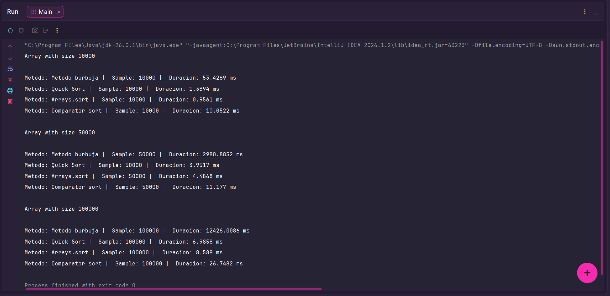
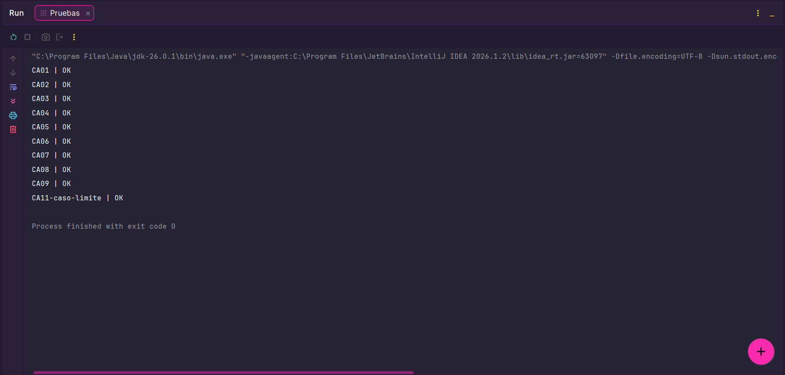

# PL1.1 — Comparativa de métodos de ordenamiento y benchmarking

## Datos generales

| Campo | Información |
|---|---|
| Institución | Universidad Politécnica Salesiana |
| Carrera | Computación |
| Asignatura | Estructura de Datos |
| Práctica | PL1.1 — Comparativa de métodos de ordenamiento y benchmarking |
| Docente | Ing. Pablo Torres, Mgtr. |
| Autor | Sebastián Cárdenas |
| Repositorio | [icc-est-u2-comparativa](https://github.com/Sebitou69/icc-est-u2-comparativa) |

## 1. Objetivo

Comparar el tiempo de ejecución de cuatro variantes de ordenamiento ascendente mediante un generador de muestras, un medidor independiente basado en `Runnable` y una lista de resultados.

## 2. Entorno de ejecución

| Componente | Información |
|---|---|
| Sistema operativo | Windows |
| Versión de Java | JDK 26.0.1 |
| IDE | IntelliJ IDEA 2026.1.2 |
| Procesador | [Completar modelo exacto del equipo de la medición] |
| Memoria RAM | [Completar capacidad del equipo de la medición] |

## 3. Métodos comparados

| Variante | Método | Entrada | Implementación |
|---|---|---|---|
| V1 | Burbuja | `int[]` | `Ordenamiento.bubbleSort` |
| V2 | Quick Sort | `int[]` | `Ordenamiento.quickSort` |
| V3 | `Arrays.sort` | `int[]` | `Ordenamiento.arraysSort` |
| V4 | `Arrays.sort` con `Comparator<Integer>` | `Integer[]` | `Ordenamiento.comparatorSort` |

La variante V4 utiliza objetos `Integer` y un comparador ascendente (`Integer::compare`). `Comparator` define el criterio de comparación; no es otro algoritmo de ordenamiento.

## 4. Estructura del proyecto

```text
icc-est-u2-comparativa/
├── src/
│   ├── Main.java
│   ├── Generador.java
│   ├── Ordenamiento.java
│   ├── Benchmark.java
│   ├── Results.java
│   ├── Experimentos.java
│   └── Pruebas.java
├── evidencias/
│   ├── pruebas.md
│   └── assets/
│       ├── pruebas-consola.png
│       └── resultados-consola.png
├── README.md
└── INVESTIGACION.md
```

| Archivo | Responsabilidad |
|---|---|
| `Generador.java` | Crea arreglos `int[]` con valores aleatorios entre 0 y `size`, inclusive; rechaza tamaños negativos. |
| `Ordenamiento.java` | Implementa los dos métodos propios y las dos variantes de biblioteca. |
| `Benchmark.java` | Recibe un `Runnable`, el nombre y el tamaño de la muestra; mide con `System.nanoTime()`. |
| `Results.java` | Guarda nombre, `sample` y duración como `long` en nanosegundos; la presenta en milisegundos. |
| `Experimentos.java` | Genera muestras, prepara copias, ejecuta y valida los 12 ordenamientos y acumula los resultados. |
| `Pruebas.java` | Comprueba casos de aceptación por separado de los benchmarks. |
| `Main.java` | Imprime la lista completa, agrupada por tamaño, después de concluir las mediciones. |

## 5. Compilación y ejecución

Desde IntelliJ IDEA, ejecutar `Pruebas.main()` para las verificaciones y `Main.main()` para las mediciones.

Alternativamente, desde una terminal en la raíz del repositorio, con el JDK instalado:

```bash
javac -d build src/Generador.java src/Ordenamiento.java src/Benchmark.java src/Results.java src/Experimentos.java src/Main.java src/Pruebas.java
java -cp build Pruebas
java -cp build Main
```

Antes de compilar, crear la carpeta `build` si todavía no existe. Los archivos compilados no se incluyen en el repositorio.

## 6. Procedimiento del benchmarking

- Se generan **una muestra por tamaño** para 10 000, 50 000 y 100 000 elementos.
- Cada variante recibe una **copia independiente** de la misma muestra original, conservando los valores y el orden inicial.
- La conversión a `Integer[]`, los clones, el comparador y las lambdas se preparan antes de la medición.
- `Benchmark.medir` mide la operación `Runnable` con `System.nanoTime()` y guarda la diferencia en nanosegundos como `long`.
- `Results.getDurationMs()` convierte el tiempo a milisegundos dividiendo entre `1_000_000.0`. `sample` representa la cantidad de elementos ordenados.
- Después de detener el cronómetro se compara la salida con una referencia ordenada. Solo se agrega a `List<Results>` un resultado que supere la validación.
- Las excepciones se propagan y se conserva la causa original. Una ejecución fallida no produce un tiempo de cero ni se agrega como resultado válido.
- La generación, la conversión, la clonación, la verificación y la impresión quedan **fuera** del intervalo medido. El trabajo interno que cada algoritmo requiere para ordenar sí forma parte de su duración.

## 7. Resultados obtenidos

Estos valores se transcriben de la captura de la ejecución de `Main` en IntelliJ IDEA. Corresponden a una ejecución por variante y tamaño.



| Método | Sample | Tiempo (ms) |
|---|---:|---:|
| Método burbuja | 10 000 | 53.4269 |
| Quick Sort | 10 000 | 1.3894 |
| Arrays.sort | 10 000 | 0.9561 |
| Comparator sort | 10 000 | 10.0522 |
| Método burbuja | 50 000 | 2980.8852 |
| Quick Sort | 50 000 | 3.9517 |
| Arrays.sort | 50 000 | 4.4868 |
| Comparator sort | 50 000 | 11.177 |
| Método burbuja | 100 000 | 12426.0086 |
| Quick Sort | 100 000 | 6.9858 |
| Arrays.sort | 100 000 | 8.588 |
| Comparator sort | 100 000 | 26.7482 |

Los valores se conservan con la precisión decimal mostrada en consola, sin redondearlos ni sustituirlos por tiempos de otras ejecuciones.

## 8. Pruebas y evidencias



El registro de entradas, expectativas, resultados observados y estados de CA01–CA11 se encuentra en [evidencias/pruebas.md](evidencias/pruebas.md). La traza manual del algoritmo investigado corresponde al entregable de investigación.

## 9. Análisis de los resultados — completar personalmente

Responder con referencia a los valores concretos de la tabla:

1. ¿Cómo cambió el tiempo de cada método entre 10 000, 50 000 y 100 000 elementos?
2. ¿Cuál registró el menor tiempo para cada tamaño en esta ejecución?
3. ¿Por qué todas las variantes deben recibir un clon nuevo de la misma muestra?
4. ¿Qué diferencias influyen al comparar `int[]` frente a `Integer[]` con `Comparator`?
5. ¿Qué operaciones se midieron y cuáles quedaron fuera? ¿Qué limita una única ejecución por variante y tamaño?

[Redactar aquí el análisis personal de los resultados.]

## 10. Conclusiones — redacción personal obligatoria

La guía solicita al menos tres conclusiones propias, sin generación ni reescritura mediante IA. Cada una debe apoyarse en cifras reales de la tabla e indicar una decisión de implementación o una limitación.

1. [Conclusión personal basada en un método, un tamaño y un tiempo concreto.]
2. [Conclusión personal sobre una diferencia de representación, implementación o crecimiento.]
3. [Conclusión personal sobre las limitaciones de medir una sola ejecución.]

## 11. Entrega

- Repositorio remoto: [Sebitou69/icc-est-u2-comparativa](https://github.com/Sebitou69/icc-est-u2-comparativa)
- Hash del commit definitivo entregado en AVAC: [Completar después del último push]
- Documento de investigación independiente: [INVESTIGACION.md](INVESTIGACION.md)
